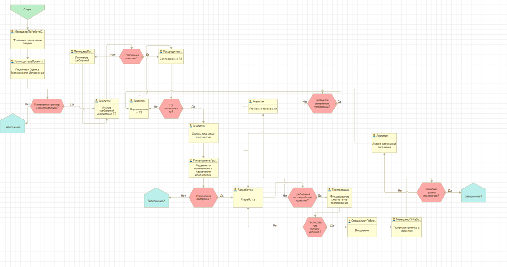
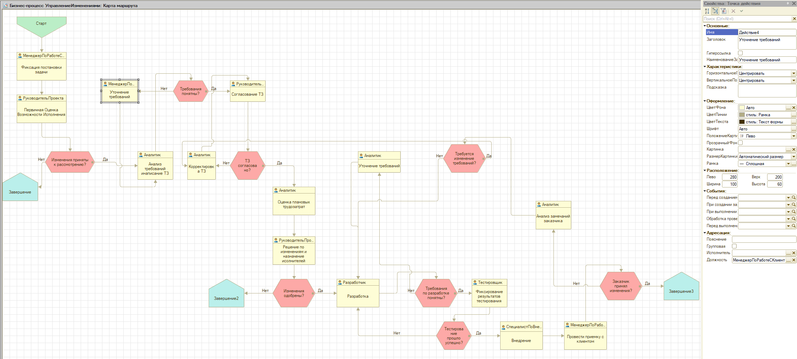

# Case-
мой тестовый пример   
# Кейс по системной аналитике - сервис совместного планирования путешествий

## Требования

Сервис позволяет пользователю спланировать поездку: подобрать билеты, отели, трансферы, активности. Все бронирования синхронизируются в едином интерфейсе, система выдаёт рекомендации на основе интересов и истории.

#### Функциональные требования
- Поиск и бронирование билетов/отелей
- Планирование маршрута путешествия
- Синхронизация расписаний и уведомлений
- Персонализированные рекомендации
- Уведомления о задержках и изменениях
- Обратная связь по поездке
#### Особенности проектирования:
- Многопользовательский режим (семейные или групповые поездки)
- Интеграции с внешними API (авиаперевозчики, букинги)
- Обработка платежей, паспортных данных
- Работа с тайм-зонами и международными форматами данных
- Вызовы
- Конфликты расписаний и пересадок
- Персонализация без утечки данных
- Надёжность при отказах внешних API

| Rank | Languages |
|-----:|-----------|
|     1| JavaScript|
|     2| Python    |
|     3| SQL       |

[use case](https://github.com/chipuchka/Case-/blob/69f685df643efc5bba66be7f6355acd16f21f578/use%20case.md)

[лаба 7.1.docx](https://github.com/user-attachments/files/32078961/7.1.docx)

### [User Stories](https://github.com/chipuchka/Case-/blob/5b67c71bd88132ee1715f9eefad655264bae0704/User%20Stories.md)

### [BPMN](https://github.com/chipuchka/Case-/blob/8696de95f3eceb87df673a2596caf87d7cff29b2/diagram.png)

