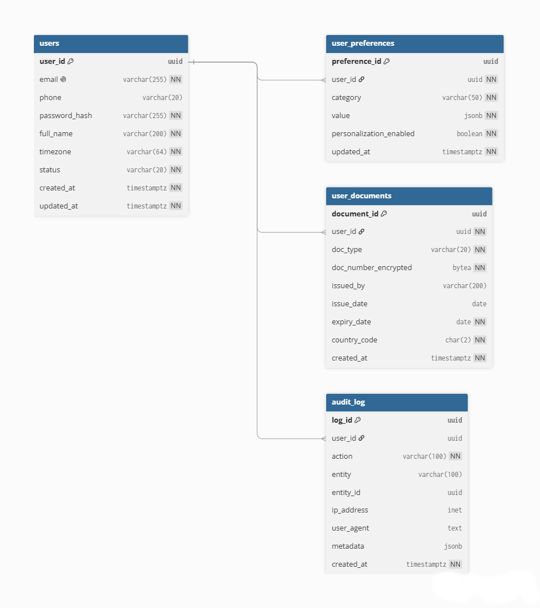

## 1. Identity Service (пользователи, профили, паспорта, аудит) 

### Таблица users
| Поле | Тип | Ограничения | Описание |
|------|-----|-------------|----------|
| user_id | UUID | PK, DEFAULT gen_random_uuid() | Идентификатор |
| email | VARCHAR(255) | NN, UK | Логин, уникальный |
| phone | VARCHAR(20) | — | Телефон (опционально) |
| password_hash | VARCHAR(255) | NN | Хэш пароля  |
| full_name | VARCHAR(200) | NN | Имя |
| timezone | VARCHAR(64) | NN, DEFAULT 'UTC' | Тайм-зона (IANA) |
| status | VARCHAR(20) | NN, DEFAULT 'active', CK: status IN ('active','blocked','deleted') | Статус |
| created_at | TIMESTAMPTZ | NN, DEFAULT now() | Дата регистрации |
| updated_at | TIMESTAMPTZ | NN, DEFAULT now() | Дата обновления |

### Таблица user_preferences
| Поле | Тип | Ограничения | Описание |
|------|-----|-------------|----------|
| preference_id | UUID | PK | Идентификатор |
| user_id | UUID | FK → users.user_id, NN | Пользователь |
| category | VARCHAR(50) | NN | Категория (interests/budget/food/transport) |
| value | JSONB | NN | Гибкие данные |
| personalization_enabled | BOOLEAN | NN, DEFAULT true | Согласие на персонализацию |
| updated_at | TIMESTAMPTZ | NN, DEFAULT now() | Дата обновления |

### Таблица user_documents
| Поле | Тип | Ограничения | Описание |
|------|-----|-------------|----------|
| document_id | UUID | PK | Идентификатор |
| user_id | UUID | FK → users.user_id, NN | Владелец |
| doc_type | VARCHAR(20) | NN, CK: doc_type IN ('passport','visa','insurance') | Тип |
| doc_number_encrypted | BYTEA | NN | Зашифрованный номер |
| doc_number_hash | VARCHAR(64) | NN, IDX | SHA-256 для поиска без расшифровки |
| issued_by | VARCHAR(200) | — | Кем выдан |
| issue_date | DATE | — | Дата выдачи |
| expiry_date | DATE | NN, CK: expiry_date > issue_date | Дата истечения |
| country_code | CHAR(2) | NN | ISO 3166-1 |
| created_at | TIMESTAMPTZ | NN, DEFAULT now() | Дата создания |

### Таблица audit_log
| Поле | Тип | Ограничения | Описание |
|------|-----|-------------|----------|
| log_id | UUID | PK | Идентификатор |
| user_id | UUID | FK → users.user_id, NN | Кто действовал |
| action | VARCHAR(100) | NN | Действие (view_passport, refund, login) |
| entity | VARCHAR(100) | — | Сущность |
| entity_id | UUID | — | ID сущности |
| ip_address | INET | — | IP |
| user_agent | TEXT | — | User-Agent |
| metadata | JSONB | — | Доп. данные |
| created_at | TIMESTAMPTZ | NN, DEFAULT now() | Когда |
